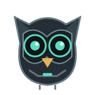

# Glitch

**A local-first Windows AI companion that turns your instructions into visible, approval-gated work.**

Glitch helps you inspect a project, edit files, run supported tests, and interact with your desktop or Chrome. Download or import a GGUF model inside Glitch, load it, describe a task, and follow the work in a live execution timeline. Glitch asks before changing files, running commands, capturing screenshots, or controlling your computer.

An optional cloud supervisor checks the local worker for errors, repeated actions, and drift. Its corrections stay attached to the conversation so the worker can resume with a persistent anchor. The robotic owl is your status companion, not a promise that AI output is always correct.

## Download and start

1. Download **Glitch.exe** from [the latest Windows release](https://github.com/gr00t-iam/Glitch/releases/latest).
2. Install [Microsoft Edge WebView2 Runtime](https://developer.microsoft.com/en-us/microsoft-edge/webview2/) if it is missing. No Ollama, LM Studio, Python or Node.js installation is needed.
3. Double-click **Glitch.exe**. Running the packaged app requires no Python, Node.js, npm, or terminal.
4. Choose a trusted project folder. In **Settings & connections > Model Manager**, paste a public Hugging Face GGUF file URL and click **Download model**, or import a GGUF. Select it and click **Load model**.
5. Describe a task and review approval requests before allowing actions.

Windows 10/11 x64 is the supported desktop target. The CPU inference engine and Python runtime are bundled; model weights are downloaded separately because of their size and licensing. Install Chrome for browser tasks and the appropriate project tools for test/build recipes. Unsigned releases may show a Windows SmartScreen warning.

[First-run guide](<START HERE - How to run Glitch.md>) | [Detailed setup and build guide](glitch/README.md)

## What Glitch does

| Capability | What you control |
| --- | --- |
| Project assistance | Choose a workspace; inspect files and approve proposed edits with diffs. |
| Built-in local reasoning | Download, import, load and unload GGUF models without an external inference server. |
| Flexible supervisor connection | OpenRouter/OpenAI/Anthropic developer APIs or a provider-authorized, loopback account bridge. |
| Hybrid supervision | Opt into cloud audits after errors, repeated steps, or a configurable interval. |
| Computer and Chrome control | Approve clicks, typing, scrolling, browser navigation and screenshots. |
| Execution timeline | See verified tool results, file changes, command output and corrections. |
| Persistent conversations | Resume conversations and their verified evidence and correction anchors after restarting. |
| Private Discord control | Assign tasks and approve actions remotely through a bot restricted to your User ID and optional private channel. |

Try: "Inspect this project and explain how it is organized," "Run the supported tests and investigate failures," or "Draft a change to this file and show me the diff."

## Safety and privacy

- File tools are confined to the selected workspace; sensitive paths are protected.
- Commands use fixed recipes, not arbitrary model-generated shell strings. Tests and builds still execute project code: use trusted workspaces.
- The cloud supervisor cannot bypass approvals or grant administrator privileges.
- Local-only mode makes no supervisor requests. Model downloads, Chrome pages and Discord can still involve network traffic.
- Hybrid mode shares your task and up to 15 recent redacted tool records with your chosen provider. Redaction is not a guarantee that every secret is detected.
- Discord can receive task output and explicitly approved screenshots. Glitch must remain open; native computer control needs an awake, unlocked Windows desktop.
- Conversations live in SQLite under `%LOCALAPPDATA%\Glitch`; saved API keys and bot tokens use Windows DPAPI.

Glitch is not an OS sandbox, a general-purpose unrestricted shell, a corporate network bypass, or a guarantee against hallucinations. Supervision helps detect drift; users remain responsible for reviewing consequential actions.

**Subscription access is not a free API switch.** Glitch can connect to an authorized local OpenAI-compatible bridge and open its sign-in page. It does not ship a proxy, impersonate official OAuth clients, extract cookies, or collect consumer session tokens. ChatGPT account access requires a supported integration and applicable plan limits. Anthropic does not permit third-party routing through Claude Pro/Max credentials; use a developer API key. See [Anthropic's authentication rules](https://code.claude.com/docs/en/legal-and-compliance) and [OpenAI's sign-in integration documentation](https://developers.openai.com/siwc).

## Which code powers the application?

**The supported executable is the Python/PyWebView app in `glitch/`.** Its HTML interface is bundled offline; it does not run the old development web server.

The React/Vite prototype (`src/`, `runtime/`, `server/`) and Electron prototype (`desktop/`) are retained for development reference. Features found there, including prototype stores and repository integrations, are not automatically available in `Glitch.exe`. Do not expose prototype development endpoints as a production service.

[Architecture and maintainer handoff](<Glitch - Project Handoff Specification.md>) | [Legacy prototype guide](docs/legacy-development.md)

## Build and contribute

Developers need Python 3.12 x64 to build. Double-click **Build Glitch.cmd**, or follow the [exact build commands](glitch/README.md#build-from-source-on-windows). The tested PyInstaller spec is `glitch/Glitch.spec`.

The **Glitch Windows** GitHub workflow runs the Python tests and packages a Windows executable. Releases and Actions artifacts are distinct: an artifact is a ZIP you extract; a release provides the executable directly.

Report bugs through [GitHub Issues](https://github.com/gr00t-iam/Glitch/issues). Include your app version, the failed action, and a screenshot or error message. Never post API keys, Discord tokens, private project contents, or unreviewed screenshots.
