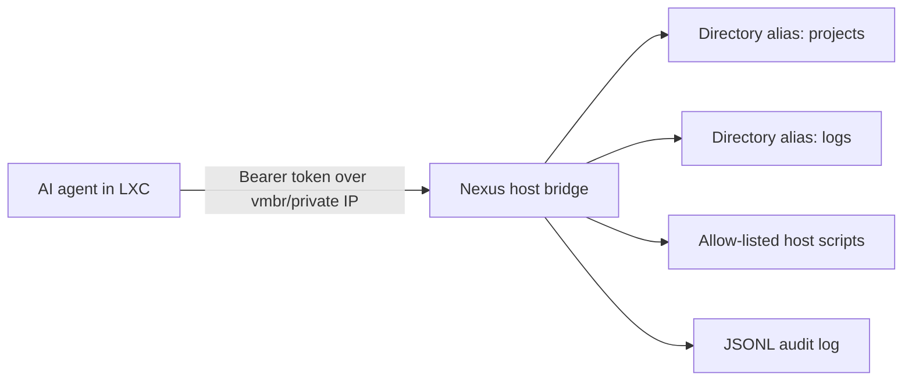

# Host Bridge for LXC Agents

Run the AI agent inside the LXC container. Run this bridge on the Proxmox host. The bridge exposes only named host directories and named scripts.

## Recommended Shape



Do not mount `/` or expose a general shell. Give the container a token and a bridge URL, and keep all host power behind explicit aliases.

## Host Setup

```bash
sudo mkdir -p /etc/nexus-host-bridge /var/log/nexus-host-bridge
sudo cp server/host_bridge_config.example.json /etc/nexus-host-bridge/config.json
sudo editor /etc/nexus-host-bridge/config.json
python -m venv /opt/nexus-host-bridge/.venv
/opt/nexus-host-bridge/.venv/bin/pip install -r server/requirements.txt
export NEXUS_HOST_BRIDGE_TOKEN="$(openssl rand -hex 32)"
export NEXUS_HOST_BRIDGE_CONFIG=/etc/nexus-host-bridge/config.json
/opt/nexus-host-bridge/.venv/bin/uvicorn server.host_bridge:app --host 10.0.3.1 --port 8787
```

Bind to the Proxmox bridge address reachable by the LXC, not `0.0.0.0`, unless a firewall limits access.

## Container Usage

```bash
export NEXUS_HOST_BRIDGE_URL=http://10.0.3.1:8787
export NEXUS_HOST_BRIDGE_TOKEN=...

curl -H "Authorization: Bearer $NEXUS_HOST_BRIDGE_TOKEN" \
  "$NEXUS_HOST_BRIDGE_URL/v1/capabilities"
```

Read a file chunk:

```bash
curl -H "Authorization: Bearer $NEXUS_HOST_BRIDGE_TOKEN" \
  "$NEXUS_HOST_BRIDGE_URL/v1/files/read?alias=projects&path=README.md&size=65536"
```

Run an allow-listed script:

```bash
curl -X POST -H "Authorization: Bearer $NEXUS_HOST_BRIDGE_TOKEN" \
  -H "content-type: application/json" \
  -d '{"args":["--dry-run"]}' \
  "$NEXUS_HOST_BRIDGE_URL/v1/scripts/backup_projects"
```

## Security Rules

- Use directory aliases, never raw host paths from the agent.
- Keep scripts in `/usr/local/sbin` or another root-owned directory.
- Use `subprocess.run(..., shell=False)` and script IDs, not arbitrary command strings.
- Run the service as a dedicated low-privilege user unless a specific script requires elevation.
- Prefer `sudoers` entries for exact scripts if elevation is needed.
- Firewall the port to the LXC subnet or specific container IP.
- Rotate `NEXUS_HOST_BRIDGE_TOKEN` if chat logs, env dumps, or container snapshots may have exposed it.
- Review `/var/log/nexus-host-bridge/audit.jsonl` regularly.

## Optional SSH/SFTP Variant

SSH/SFTP is reasonable for file transfer, but it is harder to express script-level policy. If you choose SSH:

- Create a dedicated host user such as `nexus-bridge`.
- Use key-only auth from the LXC.
- Use `ChrootDirectory` or a forced SFTP command for file-only access.
- Use forced commands in `authorized_keys` for exact host scripts:

```text
command="/usr/local/sbin/nexus-backup-projects",restrict ssh-ed25519 AAAA...
```

For agent workflows, the custom API gateway is usually clearer because every operation has a small JSON shape, an explicit allow-list, and an audit entry.
